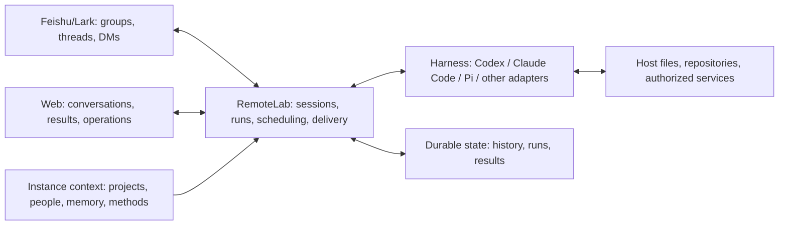

# RemoteLab

[中文](README.zh.md) | English

**An open-source, self-hosted platform for AI coworkers, built around collaboration in Feishu/Lark.**

Hand work to an AI in your team chat, continue it in the same thread, let it execute on a real machine, and receive the result where your team already works. RemoteLab connects Feishu/Lark, the web, agent runtimes, and durable context so work can carry forward from one conversation to the next.

Our goal is an AI coworker that understands what the team is trying to accomplish, remembers confirmed facts and decisions, reuses effective methods, and improves through correction. Less repeated explanation, less searching for material, fewer status requests—and usable results.

**The collaboration and runtime mechanisms are open source. The lasting value comes from the context each organization builds for itself.** Why a project made a decision, which methods actually work, who owns what, and how people collaborate emerge through ongoing work. The same code gives teams a common starting point; their own knowledge, feedback, and work history make it useful to their business.

## Working with your team

Feishu/Lark is the primary collaboration surface: assign work, add information, and correct the agent in a group, thread, or direct message; results return to the corresponding conversation. The web provides durable work history, files, and runtime management on desktop and mobile. When the agent responds in groups and which capabilities it uses depend on instance and group configuration.

| Way of working | What RemoteLab provides |
| --- | --- |
| Continue work in a project thread | Bind the conversation to a durable Session with messages, execution records, and results; follow-ups continue that work |
| Research, analyze data, or change code | Let configured agents use files, commands, repositories, and authorized tools on a macOS/Linux host |
| Turn discussion into usable output | Replies, files, report pages, and configured Feishu tools for documents, spreadsheets, Base records, tasks, and calendars |
| Pick up project background and decisions | Find relevant descriptions, history, and evidence through registered projects and sources |
| Reuse what worked | Keep methods, conditions, sources, and revisions in memory files, Skills, and an agent handbook; enable personal collaboration memory per person |
| Repeat useful work | Schedule one-time or recurring work through Triggers and Schedules, with execution and delivery records |
| Advance independent tasks in parallel | Create separate, visible work Sessions with source and handoff links, each with its own progress and results |
| Understand operations | Inspect usage, automation history, and failures across message intake, execution, and result delivery |

Capabilities depend on configuration. Feishu office operations require app permissions and resource access; project knowledge requires your own sources; enhancements such as personal memory learning are opt-in. Meeting ingestion, hardware recording, and other integrations have their own setup and validation requirements. See the [documentation index](docs/README.md).

## How context accumulates

Work produces several kinds of information. Keeping each in its proper scope helps the next task find relevant context without turning a temporary request into an organization-wide rule.

| Context | How it is retained and reused |
| --- | --- |
| What happened in this task | Session history, execution records, and result links preserve the work for continuation or lookup |
| Project goals, decisions, and understanding | A project index points to maintained source material; conclusions retain evidence and are updated in place |
| A person's collaboration preferences | Records belong to a verified identity and retain their scope; observed habits need confirmation before becoming default preferences |
| Repeatable methods | Skills, project workflows, and the agent handbook retain procedures, conditions, and experience for relevant tasks |

Retrieval starts with a small index and pointers. The agent then reads the project material, personal records, or methods relevant to the current task. Shared memory files can be used by different Harnesses, while native model threads continue through their respective runtimes.

When memory learning is enabled, explicit requests, corrections, and actual tool results can support updates. Entries retain their source, scope, and version and can be revised or withdrawn; unconfirmed inferences remain candidates. The value is tested in later work: fewer repeated corrections, better retrieval, and better results on similar tasks.

The open-source repository is for general mechanisms, documentation, and sanitized examples. An organization's project facts, personal records, internal discussions, business data, and credentials belong in its managed instance and business systems. Contributions and issue reports should contain only the minimum sanitized material needed to reproduce a problem.

## Architecture at a glance



RemoteLab owns channel connections, durable Sessions, context projection, run state, scheduled work, and result delivery. The Harness is the agent layer that interprets tasks, plans, chooses tools, and executes, retaining its native capabilities and safety mechanisms. Current native integrations include Codex, Claude Code, Pi, and Antigravity; see [Harness input](docs/native-harness-input.md). Models, accounts, and available tools depend on the operator's configuration.

A Session is a continuing work thread; a Run is an execution attempt. History and run state are persisted on disk, and execution processes are separate from the control service. Records survive browser disconnects, and the service can recover or reconcile runs after a restart. Persisted state must remain compatible with the code; check the [migration requirements](docs/request-state-upgrade.md) before upgrading.

The stack uses Node.js, a vanilla JavaScript web interface, and local runtime adapters, with no frontend build step. The Feishu connector receives events over a persistent connection; the web uses HTTP for state and WebSocket notifications for updates. See the [architecture guide](docs/project-architecture.md) for the code map.

## Quick install

Prepare a macOS/Linux host, Node.js meeting the requirements in [package.json](package.json), and at least one installed, authenticated agent tool. Feishu/Lark integration needs an administrator to create an app and configure permissions and availability. Web access can use Cloudflare Tunnel, cpolar, or Tailscale.

Open your coding agent on the target machine and give it this prompt:

```text
Deploy RemoteLab on this machine as an AI work environment for our team in Feishu/Lark.

Repository: https://github.com/Ninglo/remotelab
Setup: https://raw.githubusercontent.com/Ninglo/remotelab/main/docs/setup.md
Feishu/Lark: https://raw.githubusercontent.com/Ninglo/remotelab/main/docs/feishu-bot-setup.md

Host OS: [macOS / Linux]
Agent tools to use: [installed tools]
Web network mode: [cloudflare / cpolar / tailscale]
Feishu environment: [Feishu CN / Lark Global]
App administration: [I have access / an administrator must help]

Inspect the existing environment first; clone the repository if needed.
For an existing instance, check upgrade and migration requirements first.
Collect missing inputs together, including domain/network configuration,
agent authentication status, and Feishu app configuration.
Follow the guides through all automatable installation, service setup, and validation.
For required human login, authorization, or console actions, explain the exact
action and how you will resume afterward.
Keep credentials in instance configuration, out of the repository and public examples.
Finally verify web access and one real Feishu message from receipt through execution
and reply. Return the working entry points and any unfinished items.
```

The [setup contract](docs/setup.md) and [Feishu guide](docs/feishu-bot-setup.md) contain the full requirements and human-only steps. You can also start with the web and add Feishu later. Operators pay for their own model usage, host, and external services.

## Data and access boundaries

RemoteLab supports a shared instance for a trusted team. **Every authenticated Person in an instance has full access to its Sessions.** Identity supports attribution, preferences, and personal views; it does not provide per-person or per-group Session isolation. Use separate instances with appropriate operating-system permissions for different trust boundaries. A Feishu direct-message entry is not a private space within the instance.

Default persistent locations are below; isolated instances can override them:

| Location | Contents |
| --- | --- |
| `~/.config/remotelab/` | Authentication, connector configuration, Session history, Run records, and published results |
| `~/.remotelab/memory/` | Instance-owned memory, project pointers, and personal records |
| `~/.remotelab/workspace/` | Default working files and deliverables |

Operators manage access, backups, and retention. History and run output accumulate over time; archiving a Session does not delete its data. Model providers, Feishu/Lark, and other connected services process the content sent to them during tasks. Self-hosting does not imply that all data stays on the host.

## Documentation and contributions

| Topic | Entry points |
| --- | --- |
| Deployment and Feishu/Lark | [Host setup](docs/setup.md) · [Feishu bot](docs/feishu-bot-setup.md) · [cpolar](docs/cpolar-setup.md) |
| Office work and delivery | [Feishu actions](docs/platform-skills/feishu-cli.md) · [Static page publishing](docs/platform-skills/stable-static-publish.md) |
| Context and memory | [Memory and organizational collaboration](docs/memory-architecture/README.md) · [Personal memory and agent handbook](docs/memory-learning.md) |
| Scheduled work and independent Sessions | [Automations](docs/task-center-v1.md) · [Work handoffs](docs/platform-skills/session-delegate.md) |
| Implementation and diagnosis | [Architecture](docs/project-architecture.md) · [Harness input](docs/native-harness-input.md) · [Session diagnostics](docs/platform-skills/session-debug.md) |
| Code and documentation changes | [Repository guidelines](AGENTS.md) · [Tests](tests/README.md) · [Documentation delivery](docs/documentation-delivery.md) |

Contributions through [Issues](https://github.com/Ninglo/remotelab/issues) and pull requests are welcome. Describe the user's intended outcome, actual behavior, and reproduction conditions. Preserve useful mechanisms and evidence while removing real identities, private content, credentials, and links that grant access to internal resources.

## License

[MIT](LICENSE).
