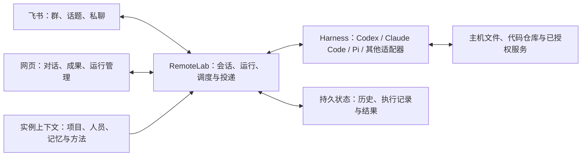

# RemoteLab

[English](README.md) | 中文

**以飞书为主要协作入口、可自托管的开源 AI 同事运行平台。**

把工作交给群里的 AI，让它沿着话题继续做、在真实机器上执行，并把结果交回团队正在使用的地方。RemoteLab 连接飞书、网页、Agent 执行环境与持久上下文，让一次对话中的工作能够延续到下一次协作。

我们关心的是：AI 能否理解团队在做什么，记住已经确认的事实和决定，复用有效的方法，并在人的纠正下改进。少重复解释，少找材料，少追问进展，最终交出能用的结果。

**开源的是协作与运行机制；长期形成差异的是每个组织自己积累的上下文。** 项目为何这样决策、哪些方法在实际工作中有效、不同人的职责与协作习惯，都需要在持续合作中建立。部署同一份代码提供共同的起点，组织自己的知识、反馈和工作记录让它逐渐成为熟悉业务的同事。

## 在团队里怎么用

飞书是日常协作入口：在群、话题或私聊里交办、补充和纠正，结果回到对应对话。网页提供持续工作记录、文件和运行管理，手机与桌面都能访问。群内何时响应、使用哪些能力，由实例与群配置决定。

| 工作方式 | RemoteLab 提供什么 |
| --- | --- |
| 在项目话题里持续推进一件事 | 将对话绑定到持久 Session，保留消息、执行记录和结果；后续补充继续原工作 |
| 整理资料、分析数据、修改代码 | 让配置好的 Agent 在 macOS/Linux 主机上使用文件、命令、代码仓库和已授权工具 |
| 把讨论变成可使用的成果 | 回复、文件、报告页面，以及通过已配置的飞书工具维护文档、表格、多维表格、任务和日历 |
| 接续项目背景与既有决定 | 按已登记的项目和来源找到相关说明、历史与证据，减少每次从头解释 |
| 把有效做法用于下一次工作 | 通过记忆文件、Skills 和行动手册保存适用条件、来源与修订；个人协作记忆按人启用 |
| 定时处理重复工作 | 用 Trigger／Schedule 安排一次性或周期工作，查看每次执行和结果投递状态 |
| 并行推进独立任务 | 创建可打开的独立工作 Session，保留来源与交接关系，分别查看过程和成果 |
| 了解运行情况 | 查看用量、自动化记录和失败原因，定位消息接收、执行与结果投递中的问题 |

这些能力以实际配置为准：飞书办公操作需要相应应用权限和资源访问权；项目知识需要接入自己的资料；个人记忆学习等增强功能需单独启用。会议采集、硬件录音和其他外部连接也有各自的安装与验证条件，见[文档目录](docs/README.md)。

## 上下文怎样积累

一次工作会留下不同用途的信息。把它们按归属保存，下一次才能读到相关内容，而不会把某次临时要求扩展成全组织规则。

| 内容 | 保存与复用方式 |
| --- | --- |
| 这次工作发生了什么 | Session 历史、执行记录和成果链接保留过程，后续可以接续或回查 |
| 项目目标、决定与认识 | 项目索引指向维护中的项目资料，具体结论保留来源；状态变化时回到原处更新 |
| 人的称呼与协作偏好 | 归属于已核实身份的个人记录，带上适用范围；观察到的习惯需确认后才作为默认偏好 |
| 可重复执行的方法 | Skills、项目工作流与行动手册保存步骤、条件和经验，按任务选择使用 |

读取采用“先找入口，再读相关正文”的方式。启动时提供精简索引和指针，Agent 根据当前任务读取项目资料、人员记录或方法。共享的记忆文件可以供不同 Harness 使用；原生模型线程仍按各自的运行方式接续。

启用记忆学习后，人的明确要求、纠正和实际工具结果可以成为更新依据。条目保留来源、范围和版本，可以修订或撤销；未确认的推断保留为候选。这种积累要靠后续真实工作检验：是否减少重复纠正，是否找到正确材料，是否把同类工作做得更好。

开源仓库适合保存通用机制、文档和脱敏示例。组织自己的项目事实、人员记录、内部讨论、业务数据和凭据应留在其管理的实例及业务系统中。贡献代码或反馈问题时，只提供复现所需的最小脱敏材料。

## 运行机制



RemoteLab 负责入口连接、持久会话、上下文提供、运行状态、定时工作和结果投递。Harness 是实际理解任务、规划、选择工具和执行工作的 Agent 层，保留其原生能力与安全机制。当前原生接入包括 Codex、Claude Code、Pi 和 Antigravity，详见[运行接入说明](docs/native-harness-input.md)。模型、账号与可用工具取决于部署者的配置。

新会话默认走 Auto：普通工作使用 `gpt-6-astra / xhigh`，快速档使用 GPT-6.1 Sol/low，明确选择 medium 时使用 Astra/medium；经济档保留 Luna/low。手动模式默认模型为 Astra，`/quick` 默认使用 GPT-6.1 Sol/low，已有普通会话保留已选模型。实例可覆盖这些默认值，详见[默认模型配置](docs/setup.md#jev-auto-model-routing)。

Session 是持续工作的单位，Run 是一次执行。历史和运行状态落盘，控制服务与执行进程分离；浏览器断开后记录仍在，服务重启后可依据持久状态恢复或核对运行。具体状态格式需与源码兼容，升级前按[迁移说明](docs/request-state-upgrade.md)检查。

技术栈为 Node.js、原生 JavaScript 网页与本地运行适配器，无前端构建步骤。飞书通过长连接接收事件，网页提供 HTTP 状态读取和 WebSocket 更新通知。代码位置见[架构说明](docs/project-architecture.md)。

## 快速安装

准备一台 macOS/Linux 主机、符合 [package.json](package.json) 要求的 Node.js，以及至少一个已经安装并完成认证的 Agent 工具。接入飞书需要管理员创建应用、配置权限和可用范围；网页访问可按需选择 Cloudflare Tunnel、cpolar 或 Tailscale。

在目标机器上打开自己的 coding agent，把下面这段交给它：

```text
请在这台机器上部署 RemoteLab，作为团队通过飞书协作的 AI 工作环境。

仓库：https://github.com/Ninglo/remotelab
安装说明：https://raw.githubusercontent.com/Ninglo/remotelab/main/docs/setup.md
飞书接入：https://raw.githubusercontent.com/Ninglo/remotelab/main/docs/feishu-bot-setup.md

主机系统：[macOS / Linux]
准备使用的 Agent 工具：[已安装的工具名称]
网页网络模式：[cloudflare / cpolar / tailscale]
飞书环境：[飞书中国版 / Lark 国际版]
应用管理员：[我有管理权限 / 需要管理员协助]

先检查现有环境；仓库尚未存在时自行克隆。已有实例先核对升级与迁移要求。
开始前一次收齐缺少的信息，包括域名或网络配置、Agent 认证状态和飞书配置。
沿说明完成可自动执行的安装、服务配置和验证。
必须人工处理的登录、应用授权或控制台操作，请说明具体动作及接续方式。
凭据留在实例配置中，不写入仓库或公开示例。
最后验证网页访问，以及飞书一条真实消息的接收、执行和回复，返回入口与未完成项。
```

完整要求和人工操作见[安装说明](docs/setup.md)与[飞书接入说明](docs/feishu-bot-setup.md)。也可以先使用网页，再接入飞书。模型使用、主机与外部服务的费用由部署者承担。

## 数据与访问边界

RemoteLab 面向可信团队共享实例。**同一实例内，所有已认证 Person 都有完整的 Session 访问权。** 人员身份用于归因、偏好和个人视图，不提供逐人或逐群的 Session 权限隔离。需要不同信任边界时，应使用独立实例并配置相应的系统权限；不能把飞书私聊入口理解为实例内私有空间。

默认持久数据位于以下目录，独立实例可以覆盖路径：

| 位置 | 内容 |
| --- | --- |
| `~/.config/remotelab/` | 认证、连接器配置、Session 历史、Run 记录及发布成果 |
| `~/.remotelab/memory/` | 实例自己的记忆、项目索引与人员记录 |
| `~/.remotelab/workspace/` | 工作文件与交付物的默认目录 |

部署者负责这些数据的访问控制、备份和保留策略。对话历史与运行输出会持续积累；归档 Session 不会删除其数据。模型提供商、飞书及其他已连接服务会处理任务中发送给它们的内容，自托管不等于全部数据都留在本机。

## 继续阅读与参与

| 想了解什么 | 入口 |
| --- | --- |
| 部署与飞书接入 | [主机安装](docs/setup.md) · [飞书机器人](docs/feishu-bot-setup.md) · [cpolar](docs/cpolar-setup.md) |
| 日常办公与结果交付 | [飞书操作](docs/platform-skills/feishu-cli.md) · [发布静态页面](docs/platform-skills/stable-static-publish.md) |
| 上下文与记忆维护 | [记忆与组织协作](docs/memory-architecture/README.md) · [人员记忆与行动手册](docs/memory-learning.md) |
| 定时工作与独立 Session | [自动化](docs/task-center-v1.md) · [工作交接](docs/platform-skills/session-delegate.md) |
| 实现与排障 | [系统架构](docs/project-architecture.md) · [Harness 接入](docs/native-harness-input.md) · [会话诊断](docs/platform-skills/session-debug.md) |
| 修改代码与文档 | [仓库约定](AGENTS.md) · [测试](tests/README.md) · [文档同步](docs/documentation-delivery.md) |

欢迎通过 [Issues](https://github.com/Ninglo/remotelab/issues) 和 Pull Requests 贡献问题、修复和通用能力。描述用户想完成的工作、实际结果和复现条件，保留有用的机制与证据，移除真实人员、私有内容、凭据及可访问内部资源的链接。

## 许可证

[MIT](LICENSE)。
